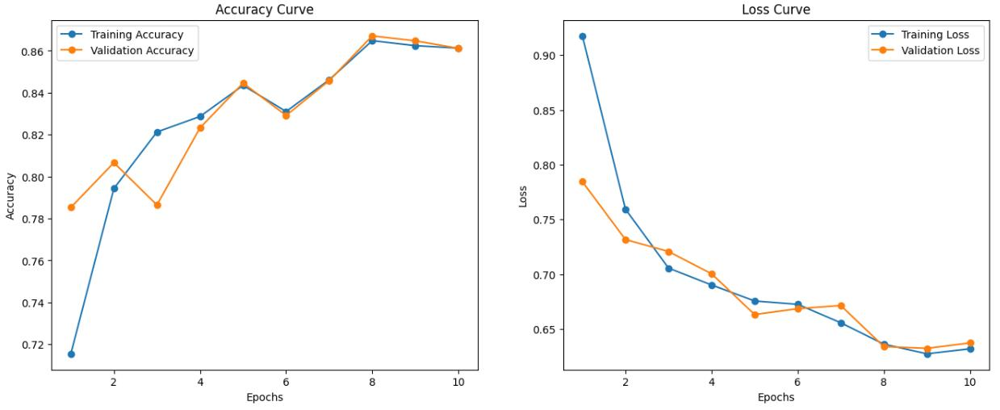
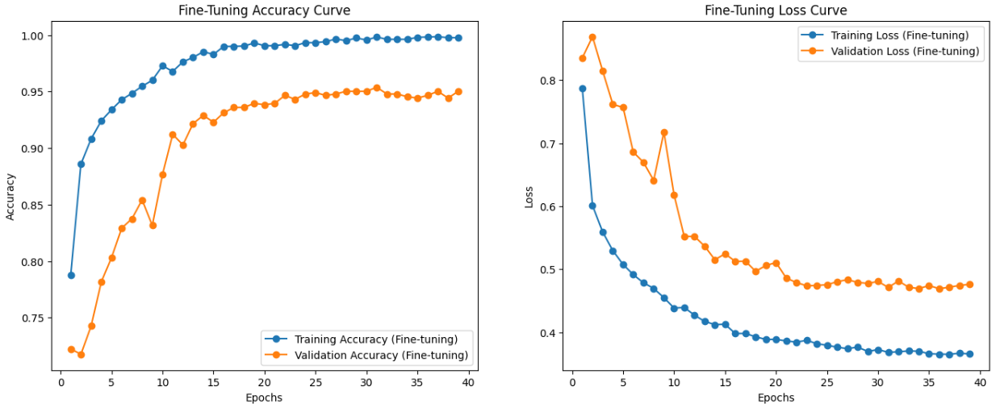
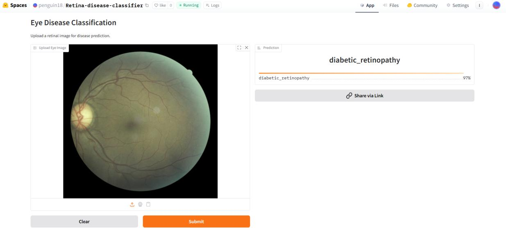
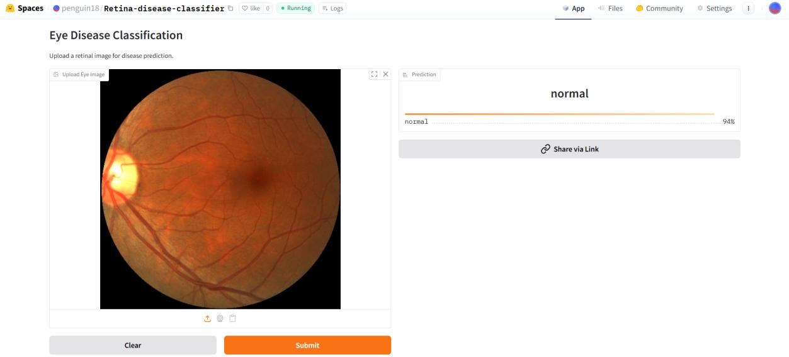

# Automated Ocular Disease Detection in Retinal Images Using Transfer Learning

A deep learning project that classifies retinal fundus images into four
categories: **Cataract, Glaucoma, Diabetic Retinopathy, and Normal**.
Multiple pretrained CNN architectures were compared, and
**MobileNetV3-Large** was selected for its balance of classification
performance and computational efficiency.

## Live Demo

**Hugging Face Space:** [Try the retinal disease
classifier](https://huggingface.co/spaces/penguin18/Retina-disease-classifier)

The application accepts a retinal fundus image and returns a predicted
class with a confidence score.

## Project Highlights

-   Four-class retinal fundus image classification.
-   Comparative evaluation of five pretrained CNN architectures.
-   Transfer learning with feature extraction followed by fine-tuning.
-   Image augmentation to support generalization.
-   Gradio interface deployed on Hugging Face Spaces.

## Tech Stack

-   **Language:** Python
-   **Deep Learning:** TensorFlow, Keras
-   **Architectures:** MobileNetV3-Large, EfficientNetB0,
    EfficientNetB3, ResNet50, DenseNet201
-   **Data & Visualization:** NumPy, Pandas, Matplotlib
-   **Deployment:** Gradio, Hugging Face Spaces
-   **Training environment:** Kaggle Notebooks with NVIDIA Tesla T4 GPUs

## Dataset

The project uses the public [Eye Diseases Classification dataset on
Kaggle](https://www.kaggle.com/datasets/gunavenkatdoddi/eye-diseases-classification),
containing 4,217 retinal images across four classes.

  | Class | Images |
|:---|---:|
| Cataract | 1,038 |
| Diabetic Retinopathy | 1,098 |
| Glaucoma | 1,007 |
| Normal | 1,074 |
| **Total** | **4,217** |
An 80:20 training-validation split was used, with random seed 42.

## Methodology

1.  **Preprocessing:** Images were resized to 224 × 224 pixels and
    loaded using TensorFlow's `image_dataset_from_directory`.
2.  **Augmentation:** Random horizontal flips, rotations up to ±8°,
    zoom, and contrast variation were applied.
3.  **Model comparison:** ResNet50, DenseNet201, EfficientNetB0,
    EfficientNetB3, and MobileNetV3-Large were evaluated.
4.  **Transfer learning:** The classification head was trained with the
    pretrained backbone frozen, followed by fine-tuning with the
    backbone unfrozen.
5.  **Deployment:** The selected model was exported as
    `mobilenet_final.keras` and served through a Gradio app on Hugging
    Face Spaces.

## Results

The project report records the following model comparison:

| Model | Accuracy | Precision | Recall | F1-score |
|:---|:---:|:---:|:---:|:---:|
| ResNet50 | 94% | 95% | 94% | 94% |
| DenseNet201 | 94% | 94% | 94% | 94% |
| EfficientNetB0 | 95% | 95% | 95% | 95% |
| EfficientNetB3 | 95% | 95% | 95% | 95% |
| **MobileNetV3-Large** | **95%** | **95%** | **95%** | **95%** |

MobileNetV3-Large was selected as the final model with approximately
**9.68 million parameters**, the lowest parameter count among the five
evaluated architectures.

### Confusion Matrix

The following confusion matrix is taken from the project report.

### Accuracy and Loss Curves

The following plots are taken from the project report and show training and validation accuracy/loss for MobileNetV3-Large during feature extraction and subsequent fine-tuning.

**Feature extraction (frozen pretrained backbone)**

**Fine-tuning (backbone unfrozen)**

## Deployment Screenshots

Examples of predictions from the deployed Gradio application, as
documented in the project report:

### Diabetic Retinopathy Prediction
|  | 
### Normal Prediction

## Future Work

-   Evaluate the model on independent retinal datasets.
-   Explore additional ophthalmic disease categories.
-   Investigate explainability methods such as Grad-CAM.
-   Test robustness across different imaging devices and conditions.

## Disclaimer

This project is for educational and research purposes and is **not a
medical diagnostic tool**. Predictions may be incorrect and should not
replace assessment by a qualified ophthalmologist.

## Author

**Riya Mukherjee**\
M.Sc. Computer Science, National Institute of Technology Tiruchirappalli

-   GitHub: [18riyamukherjee03](https://github.com/18riyamukherjee03)
-   Live Demo: [Retina Disease Classifier](https://huggingface.co/spaces/penguin18/Retina-disease-classifier)
